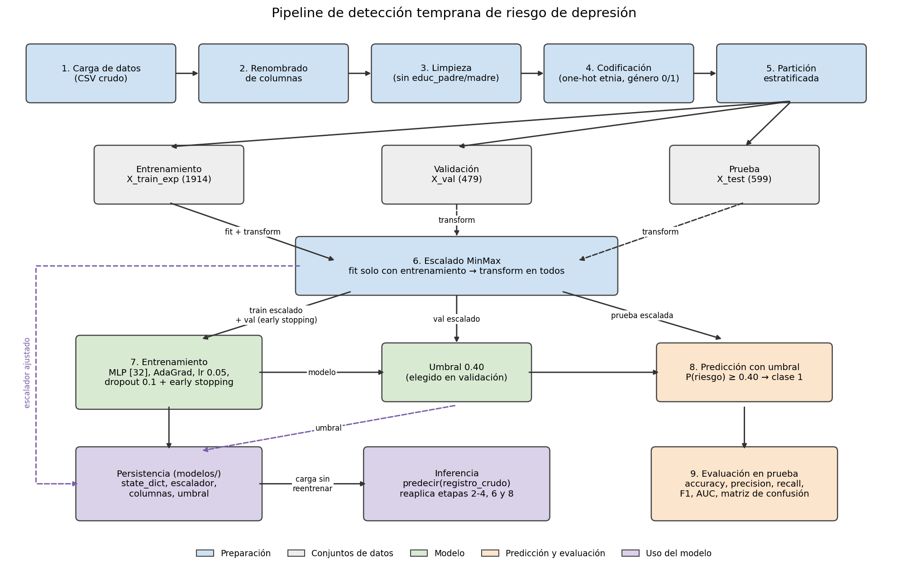
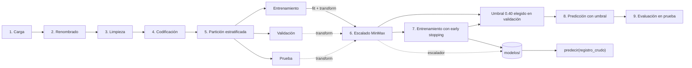

# Detección temprana de riesgo de depresión en estudiantes universitarios

Proyecto de Redes Neuronales. Estudiantes: Nicoll Quesada, Daniel Hurtado y Santiago Lozano.

Red neuronal (MLP) que estima el riesgo de depresión de un estudiante a partir de variables demográficas, de bienestar, de estrés percibido (PSS-10) y de ansiedad (GAD-7). Los datos vienen de *Self-reported subjective well-being and mental health of college students – 2022* (Mendeley Data, Universidad Icesi; DOI 10.17632/bytb22nf7m.1). La etiqueta `riesgo_dep` se construyó con k-means sobre las preguntas PHQ-9.

## Estructura

```
proyecto/
├── datos/                     data_with_depression_risk.csv
├── notebooks/pipeline.ipynb   pipeline del modelo final, de punta a punta
├── src/pipeline_riesgo.py     las mismas funciones del pipeline, para usarlas sin el notebook
├── modelos/                   mlp_final_state_dict.pt, escalador_minmax.joblib, metadatos.json
├── reportes/figuras/          diagrama_pipeline.png, evaluacion_prueba.png
├── Entrenamiento_de_Red_Neuronal_Proyecto-4.ipynb   experimentos y selección del modelo
├── requirements.txt
└── README.md
```

## Modelo final

MLP `[32]` (ReLU) | AdaGrad | lr = 0.05 | dropout 0.1 | sin L1/L2 | early stopping (paciencia 15) | escalado MinMax | **umbral de decisión 0.40**. Fue la mejor configuración, por F1 de la clase 1 en validación, de un grid de 216 corridas (ver el notebook 4).

Resultados en prueba (599 estudiantes):

| Modelo | Accuracy | Precision (1) | Recall (1) | F1 (1) | AUC |
|---|---|---|---|---|---|
| Modelo final (umbral 0.40) | 0.808 | 0.697 | **0.818** | 0.753 | 0.899 |
| Perceptrón de referencia | **0.828** | **0.768** | 0.743 | **0.755** | **0.902** |

## Pipeline





## Cómo ejecutarlo

```bash
conda activate analitica_Datos          # o cualquier entorno con Python 3.12
pip install -r requirements.txt
cd notebooks
jupyter nbconvert --to notebook --execute --inplace pipeline.ipynb
```

La ejecución tarda unos 20 segundos. El notebook entrena el modelo, verifica que el umbral elegido en validación sea 0.40, lo evalúa en prueba, guarda los artefactos en `modelos/` y comprueba que la inferencia desde disco sobre registros crudos reproduce las métricas del notebook 4.

## Predecir sin reentrenar

```python
import pandas as pd
from src.pipeline_riesgo import cargar_artefactos, predecir

artefactos = cargar_artefactos()                      # lee modelos/
registros = pd.read_csv("datos/data_with_depression_risk.csv").iloc[:5, :-1]   # columnas originales, sin la etiqueta
predecir(registros, artefactos)                        # -> probabilidad_riesgo y clase (1 = riesgo)
```

## Limitaciones

- La etiqueta es un agrupamiento estadístico (k-means sobre PHQ-9), **no un diagnóstico clínico**.
- **Circularidad parcial:** las entradas incluyen escalas muy cercanas a la etiqueta (PSS-10, GAD-7 y la pregunta 12, sobre estado depresivo). Por eso un modelo lineal ya alcanza una AUC de 0.90.
- Datos de una sola universidad y un solo año.
- El modelo es una herramienta de **apoyo** para priorizar acompañamiento; no reemplaza el criterio de un profesional.
